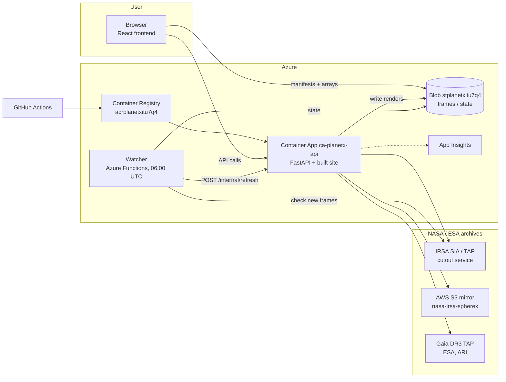
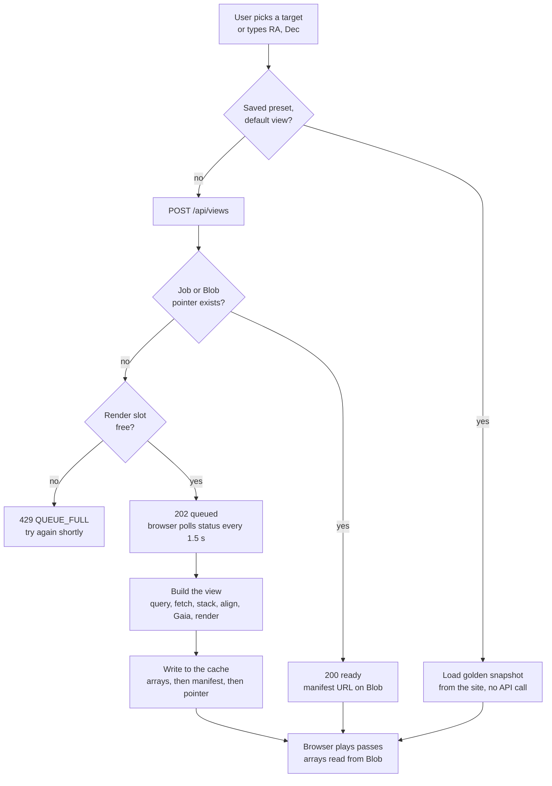

# Into The Unknown — System Design

Nov 15, 2026 · [Live doc](https://claude.ai/artifact/8Q7vG8WqYUBTQjE89zHn6g)

## Overview

Into The Unknown turns any patch of sky into a short flip-book of NASA SPHEREx images, so anything that moves or changes brightness between survey passes stands out. It is the team's entry for the NASA Space Apps 2026 challenge "Planet X and SPHEREx", also aimed at the Best Use of Azure award, and runs at [ca-planetx-api…azurecontainerapps.io](https://ca-planetx-api.politesand-6f83d8b5.westus.azurecontainerapps.io).

A user picks a target or types an RA, Dec. The backend finds every SPHEREx exposure of that spot, cleans and stacks them into one image per six-month survey pass, and the browser plays, blinks and differences those passes. Gaia DR3 predictions show where every known star should be in each pass, so a source with no Gaia track is a candidate mover.

| Target | Kind | What the demo shows |
| --- | --- | --- |
| Barnard's Star | Motion | About 1.7 px per year northward, plus a parallax wobble |
| Epsilon Indi B | Motion | Brown dwarf pair moving 4.7 arcsec per year |
| WISE 0855-0714 | Motion | Coldest known brown dwarf, visible only at 4 to 5 um |
| RW Aurigae | Variability | Irregular dimming, light curve with a calibration band |
| R Draconis | Variability | Mira pulsation across 9 passes |

Design goals:

- **Works with the archive down.** The five presets ship as saved snapshots, so the demo never depends on NASA's IRSA being up.
- **Repeat views are instant and links never break.** Renders are immutable files in Azure Blob, addressed by content keys.
- **The browser does the visual work.** The backend ships float arrays; stretch, blink and difference run client-side, so every control responds immediately.
- **Every number shown comes from our code**, never an LLM, and flagged data is marked rather than hidden.

## Architecture

The whole app runs as one Docker image on Azure Container Apps: FastAPI serves the API and the built React site from the same origin, so there is no CORS between them. Heavy files never pass through that container on the way out; the browser downloads renders straight from Azure Blob Storage.

| Component | Runs on | Responsibility |
| --- | --- | --- |
| React frontend (`frontend/`) | The user's browser | Target picker, flip-book canvas, stretch, blink, difference, measurement drawer, Gaia overlay |
| FastAPI backend (`backend/`) | Azure Container App `ca-planetx-api` | Views API, render pipeline, measurements, refresh endpoint, serves the site |
| Render cache | Azure Blob `stplanetxitu7q4`, container `frames` | Immutable renders, query pointers, the home-screen point list |
| Watcher (`functions/`) | Azure Functions, daily at 06:00 UTC | Detects new SPHEREx data and asks the API to refresh the pinned views |
| Upstream archives | NASA/IPAC IRSA, AWS S3 mirror, ESA and ARI Gaia TAP | Frame lists, image pixels, Gaia DR3 star positions |
| CI/CD | GitHub Actions + Azure Container Registry | Tests, builds and deploys every push to `main` |

## Request flow

A view is rendered at most once; after that every request for it is a pointer lookup and a download from Blob. The five presets in their default view skip the API entirely.

Two requests for the same view share one job, and a failed job is retried as a fresh miss. Measurements (spectrum, light curve, Gaia label) are separate `GET` calls made only when the drawer asks for them; for a golden preset, the frontend first registers a live view in the background so those calls have a job to read from.

## Data pipeline

Every view, saved or live, goes through the same nine steps in `backend/app/processing/`, so a preset and a fresh position are processed identically. The output is one float32 stack per survey pass on a north-up 6.15 arcsec/px grid.

1. **Find frames.** The five presets read bundled cutouts from `demo/`. Any other position asks IRSA's SIA service for the frame list, falling back to TAP; collections are matched by name (`spherex_dr*`, `spherex_qr*`) and cached for an hour. Duplicate releases of one exposure collapse to one: DR beats QR, then the newer processing date wins. Live views keep at most 120 frames, sampled evenly in time.
2. **Fetch cutouts.** Up to 10 in parallel, sized from the field of view (FOV + 1 arcmin), never full frames. Each is a byte-range read from the `nasa-irsa-spherex` S3 mirror first, with IRSA's cutout service as the fallback.
3. **Clean.** `IMAGE - ZODI`, then masking by the bit names in each file's FLAGS header (`MSKN` cards). SOURCE, OVERFLOW, NONLINEAR, FULLSAMPLE, HALO and BLOOM are kept so bright stars survive; TRANSIENT and SUR\_ERROR never mask a SOURCE pixel.
4. **Reproject** each frame onto one common TAN grid centred on the request.
5. **Group into passes.** A gap over 20 days starts a new pass, and so does a pass that spans more than 40 days. Live passes need at least 10 frames; sparse demo packs accept 2.
6. **Stack.** An inverse-variance mean per wavelength channel (17 per detector), then an equal-weight mean over the channels common to every pass, so passes compare like with like. Per-pass photometric scales come from field stars when bandpasses match.
7. **Align.** Isolated, slow Gaia stars (G at most 16.5, under 100 mas/yr) are centroided in each pass; a mean offset over 0.15 px shifts that pass's grid and re-reprojects it. The scatter is reported as `astrom_resid_px`.
8. **Gaia overlay.** Gaia DR3 stars in the field are propagated to each pass (proper motion plus parallax) and placed on the grid; a source measured within 1.0 px of a track is a match. Live views query ESA's Gaia TAP, then ARI Heidelberg's, in parallel with the fetch.
9. **Render.** One `eN.f32` stack and `eN.mask.u8` per pass, `gaia.json`, and a `manifest.json` with the grid WCS, a shared asinh stretch, per-pass metadata and every frame used.

Measurements run later, on demand. The spectrum reads one pixel across a pass's frames. The light curve does forced aperture photometry (2 px aperture, 4 to 7 px background ring) on every frame, flags points with masked or saturated pixels, and reports a calibration floor from the scatter of 3 to 6 steady field stars after each star's spectrum is fitted out.

## API contract

The contract lives in `backend/app/models.py` and is mirrored by `frontend/src/types.ts`; both are hotspots and change together. All routes are JSON, and interactive docs are at `/docs`.

| Method and path | Purpose | Success | Notes |
| --- | --- | --- | --- |
| `GET /api/health` | Liveness and IRSA probe | 200 | `irsa`: up, degraded or down (probe cached 60 s) |
| `GET /api/targets` | The five presets | 200 | Gaia DR3 astrometry, default FOV and band |
| `GET /api/status` | New-data catalog for the "data as of" badge | 200 | `catalog` is null until the watcher has run |
| `POST /api/views` | Request a view | 200 ready, or 202 queued | Body: `ra`, `dec`, `fov_arcmin`, `band`, `mode`, `source` |
| `GET /api/views/{id}` | Job status and progress | 200 | `status`: queued, query, fetch, stack, render, ready, error |
| `GET /api/views/{id}/spectrum` | One pixel across a pass | 200 | `x`, `y`, `epoch` |
| `GET /api/views/{id}/lightcurve` | Forced photometry over time | 200 | `x`, `y`, `r_px`; returns points and `comparison` |
| `GET /api/views/{id}/gaia` | Gaia tracks and per-pass matches | 200 | With `x`, `y`, `epoch`: adds the match label |
| `POST /internal/refresh` | Watcher trigger | 202 | Needs `X-Refresh-Key`, compared in constant time |

**Request limits.** `fov_arcmin` is one of 2, 4, 6, 10 or 15; `band` is auto, B1 to B6, B1-B2, B1-B3 or all; `source` is auto (saved snapshot if one exists, else live), saved or live. Pixel coordinates must be 0 or more.

**Errors.** Validation failures return 422 with FastAPI's `detail`. Everything else returns `{"error": {"code", "message"}}`, with the message written for the person using the app.

| Code | HTTP | Meaning |
| --- | --- | --- |
| `QUEUE_FULL` | 429 | 2 renders running and 10 waiting; try again shortly |
| `UNKNOWN_VIEW` | 404 | The view id is not known to this server instance |
| `IRSA_DOWN` | 503 | SIA and TAP both failed, or every cutout download failed |
| `NOT_SAVED` | 503 | `source=saved` for a position with no saved snapshot |
| `NOT_READY` | 503 | A measurement was asked for before the view finished |
| `NO_GAIA` | 503 | Gaia did not answer when the view was built |
| `BAD_EPOCH` | 503 | Pass index out of range (should be 4xx: [#89](https://github.com/ompatel181005/IntoTheUnknown/issues/89)) |
| `BAD_REFRESH_KEY` | 401 | Missing or wrong refresh key |
| `PIPELINE_ERROR` | (job status) | Unexpected failure inside a build; reported on the view's status |

## Storage and caching

A render is written once and never changed, and a small pointer says which render answers each question. That is what makes repeat views instant and shared links permanent ([PLAN 4.4](PLAN.md), `backend/app/cache/`).

| Key | Built from | Names | Cache-Control |
| --- | --- | --- | --- |
| Query key `qk` (20 hex) | `q2`, pipeline version, RA and Dec to 4 decimals, FOV, band, forced source | `frames/q/{qk}.json`: a pointer to a render key | `public, max-age=60` |
| Render key `rk` (24 hex) | Pipeline version, `qk`, the sorted list of frame ids used | `frames/r/{rk}/`: manifest, `eN.f32`, `eN.mask.u8`, `gaia.json` | `public, max-age=31536000, immutable` |

**Write order.** Arrays first, the manifest last, then the pointer swap. A reader therefore never sees a half-written render. When new frames arrive, a new render key gets a new folder and the pointer moves, while old folders stay, so old links keep working.

**Backends.** With `STORAGE_ACCOUNT_URL` set, the cache is Azure Blob through `DefaultAzureCredential` (the app's managed identity; no keys or connection strings). Without it, the same layout is written to `backend/.cache/` and served at `/frames`, so local development needs no Azure.

**Lookup.** `POST /api/views` checks an in-memory job table, then the Blob pointer. A hit returns 200 with the manifest's public Blob URL at once; a miss takes a render slot and returns 202. The browser then reads the manifest and arrays straight from Blob.

| Store | Where | Size | Purpose |
| --- | --- | --- | --- |
| Demo pack | `demo/` in the image | 12 MB | Real SPHEREx cutouts and Gaia catalogues for the five presets, built by `tools/fetch_demo.py`; presets render with IRSA down |
| Golden snapshots | `frontend/public/golden/` | 0.7 MB | Finished renders of the five presets, served with the site; presets load with the API stopped |
| Render cache | Blob `frames/r`, `frames/q` | Grows with use | Every view anyone has built |
| Point list | Blob `frames/catalog/points.json` | Small | The home screen's curated targets, pre-rendered by `tools/prewarm_points.py` |
| Watcher state | Blob `state/` (private), public copy at `frames/meta/catalog.json` | Small | Newest frame seen per position, for the "data as of" badge |

## Deployment and infrastructure

Every push to `main` is tested, built into one image and deployed automatically, with no stored Azure secrets. All resources sit in resource group `rg-planetx` in `westus`, on an Azure for Students subscription.

| Resource | Name | Configuration |
| --- | --- | --- |
| Container App | `ca-planetx-api` | 1 vCPU, 2 GiB, 0 to 1 replicas (one replica, because view jobs live in memory) |
| Container Registry | `acrplanetxitu7q4` | Images tagged by commit; deploys pin the exact digest |
| Storage account | `stplanetxitu7q4` | `frames` (public read, anonymous listing off), `state` (private); shared-key auth disabled |
| Managed identity | `id-planetx-api` | Storage Blob Data Contributor on the account, AcrPull on the registry, nothing else |
| Function App | Watcher | Timer at 06:00 UTC daily, plus an authenticated `run-now` route |
| Monitoring | Log Analytics + Application Insights | Request spans, cache hits, archive failures, latency |

**Build and deploy** (`.github/workflows/build-image.yml`):

1. Run backend, frontend, functions and script checks, and validate the saved snapshots without any archive downloads.
2. Log in to Azure through GitHub OIDC, trusted for `main` only.
3. Build the two-stage Dockerfile: Node 22 builds `frontend/dist`, then Python 3.11 installs the backend and copies in `demo/` and the built site.
4. Push to the registry and deploy that exact digest to the Container App.
5. Check `/api/health` and every saved preset. If verification fails, the previous image is restored automatically.

The watcher deploys separately (`deploy-watcher.yml`), and pull requests run the same checks in `ci.yml` without deploying.

**Configuration** is environment variables set from `infra/containerapp.json`: `STORAGE_ACCOUNT_URL`, `FRAMES_CONTAINER`, `STATE_CONTAINER`, `FRAMES_PUBLIC_BASE`, `AZURE_CLIENT_ID` (which identity to use), and two secrets, `REFRESH_KEY` and `APPLICATIONINSIGHTS_CONNECTION_STRING`. The frontend needs none: it calls the API on its own origin.

**Telemetry** is opt-in and only on when the App Insights connection string is set. It records one span per request (route, status, latency), named spans around IRSA, S3 and Gaia calls, and whether each view request was a cache hit and from which layer. Request bodies, view ids and exception text are not recorded.

## Reliability, limits and known issues

The system is built to keep the demo working when NASA's archive is not, and every upstream failure becomes a clear message rather than a hang. Each failure has a fallback:

| Failure | What happens | User sees |
| --- | --- | --- |
| IRSA SIA down | TAP queried instead | Nothing different |
| SIA and TAP both down | Live view fails fast | `IRSA_DOWN`: "The five test targets still work from cached data" |
| IRSA cutout service slow or down | Pixels come from the S3 mirror first | Nothing different |
| Gaia ESA TAP down | ARI Heidelberg queried with the same ADQL | Nothing different |
| Both Gaia services down | View builds without `gaia.json` | No Gaia overlay; the toggle hides |
| API stopped | Presets load from golden snapshots in the site | Presets work; new positions and measurements do not |
| Too many renders | 2 run, 10 wait, the rest get 429 | `QUEUE_FULL`: try again shortly |
| New SPHEREx data | Watcher calls `/internal/refresh`; only views with newer frames re-render, retried after 5 and 15 minutes | Old render served until the new one is complete |

**Limits by design.**

- One replica only. View jobs live in memory, so a second replica would answer `UNKNOWN_VIEW` for jobs started on the first. Scale-to-zero also drops in-flight refresh retries until the next catalog change.
- Live views are capped at 120 frames and take about 1.5 to 2 minutes; presets load in under 8 seconds.
- SPHEREx pixels are 6.15 arcsec, so neighbours can blend. Bright stars (Barnard's Star, RW Aur, R Dra) saturate, so their cores are masked and their photometry is flagged.
- Name search covers only the 47 listed targets; any other place needs RA, Dec.

**Open issues from QA on 2026-11-15** (all on [GitHub](https://github.com/ompatel181005/IntoTheUnknown/issues)):

| Issue | Area | Summary |
| --- | --- | --- |
| [#84](https://github.com/ompatel181005/IntoTheUnknown/issues/84) | Demo | R Dra's light curve is unavailable because its core saturates |
| [#85](https://github.com/ompatel181005/IntoTheUnknown/issues/85) | Backend | `/api/health` reports IRSA down while live views work through S3 |
| [#86](https://github.com/ompatel181005/IntoTheUnknown/issues/86) | Frontend | On phones the mode row hides Investigate and the pass label wraps |
| [#87](https://github.com/ompatel181005/IntoTheUnknown/issues/87) | Docs | Name search covers only the listed targets |
| [#88](https://github.com/ompatel181005/IntoTheUnknown/issues/88) | Frontend | Verify Share copies the link in a normal browser |
| [#89](https://github.com/ompatel181005/IntoTheUnknown/issues/89) | Backend | A bad pass index on `/gaia` returns 503 instead of 4xx |
| [#90](https://github.com/ompatel181005/IntoTheUnknown/issues/90) | Frontend | Each view load sends `POST /api/views` twice |

## Sources

- Repository: `main` @ `3832124`, read 2026-11-15
- Plan and decisions: [PLAN.md](PLAN.md), [DECISIONS.md](DECISIONS.md)
- Azure resources: [infra/BLOB-HANDOFF.md](../infra/BLOB-HANDOFF.md), `infra/containerapp.json`
- Live app: [ca-planetx-api](https://ca-planetx-api.politesand-6f83d8b5.westus.azurecontainerapps.io), tested 2026-11-15
